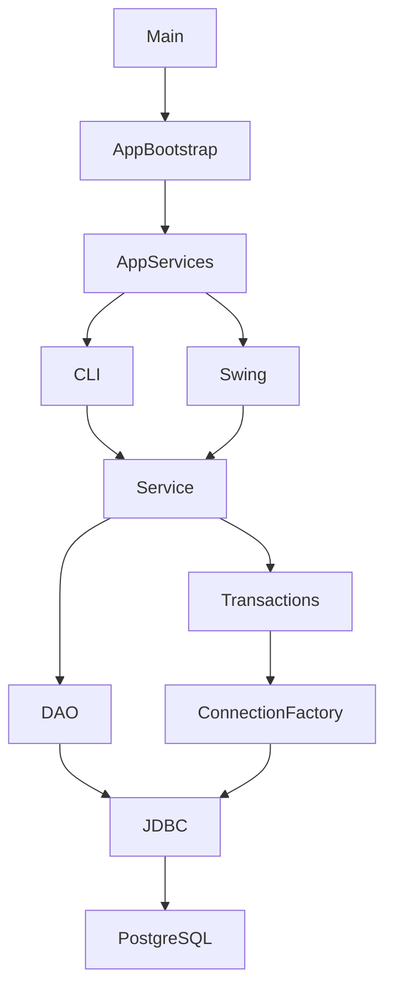

# Task4 架构与目录说明

日期：2026-11-02。用途：供 A、B 继续开发的共享架构基线。

## 1. 依据与范围

本文件区分三类内容：

- **课程要求**：车站 CRUD、线路 CRUD、指定位置插入一个或多个车站、从线路移除车站；高级部分包含两站路径、两地标路线、票价、用户界面和统一启动。所有功能都需设计命令行提示与输出。
- **团队约定**：Java 17、Maven 3.9.x、PostgreSQL 16.x、pgJDBC 42.7.14、原生 JDBC、Swing、七表模型、DTO、Service 接口、错误码与事务规则。
- **本次实现选择**：单模块 Maven 项目、不可变 Java record DTO、构造器注入、手动装配、公共事务执行器。无需引入额外依赖注入框架。

依据文件（以下路径相对于 Git 仓库根目录）：

1. `官方描述及数据/CS307-Fall26-project1.pdf`，第 7—8 页。
2. `开发约定/CS307_并行开发约定_JDBC.pdf`，第 7—12 页。
3. `create_table.sql`，当前共享 DDL。
4. A/B 已确定的分工，列于本文件第 6 节。

课程没有指定上述 Java 技术栈；这是团队选择。驱动版本与团队基线一致，并已核对 [pgJDBC 官方下载页](https://jdbc.postgresql.org/download/)。

本轮交付仅为架构。业务实现、完整数据库验收、最终界面与答辩演示仍需后续开发。

## 2. 放在哪里，操作什么数据

共享模块建议放在仓库根目录的 `Task4/` 下，源码、测试和团队文档一起同步。个人环境配置、缓存与构建产物不属于共享内容；具体清单见 README。

原始 CSV 用于初始导入；Task4 通过 JDBC 操作 PostgreSQL 当前数据，不改写 CSV。启动程序不会建表、导入、清理或重置数据库。

- `metro_line`：线路身份与中英文名。
- `line_station`：某站属于某线路、站序、运营状态、开通年、时间与原始坐标。
- `station`、`district`：车站资料和行政区。
- `station_exit`、`landmark`、`exit_landmark`：出口与地标关联。

DDL 继续以已有 仓库根目录的 `create_table.sql` 为来源；本目录不另建第二份表结构。旧 PDF 中的 `schema.sql` 指当前这份建表文件，团队接入时应统一文件引用。A 的正式导入应包含相同 DDL，并在显式写入 ID 后推进自增序列。

## 3. 调用关系



以修改线路为例：界面收集中英文名和 lineId → LineService 校验 → Transactions 开启事务 → LineDao 执行带占位符的 UPDATE → 检查影响行数 → 提交 → 返回 LineView。

目前这条业务链的接口和基础设施已建立，具体线路校验及 UPDATE 尚未实现。现有 `DatabaseDiagnostics → DatabaseInfoDao` 是可执行的只读 JDBC 示例。

## 4. 目录及各部分预期功能

```text
Task4/
├─ README.md                       打开、运行和验证方式
├─ Task4架构与目录说明.md             本说明
├─ pom.xml                         Java 17 目标、pgJDBC、JUnit、Maven 插件
├─ .gitignore                      排除缓存、构建产物、IDE 配置和真实凭据
├─ config/
│  └─ db.env.example               配置格式示例；不会自动加载
├─ docs/
│  └─ 架构审阅与验证记录.md            要求对照、结果和待办
├─ scripts/
│  └─ mvn-local.ps1                使用现有 Maven 构建或运行
├─ src/main/java/edu/cs307/metro/
│  ├─ Main.java                    统一入口和启动参数
│  ├─ bootstrap/
│  │  ├─ AppBootstrap.java         创建并注入全部服务
│  │  └─ AppServices.java          CLI、GUI 共用的服务集合
│  ├─ config/
│  │  └─ DbConfig.java             环境变量读取、配置检查、隐藏密码
│  ├─ common/
│  │  ├─ AppException.java         共用业务异常
│  │  └─ ErrorCode.java            固定错误码
│  ├─ db/
│  │  ├─ ConnectionFactory.java    每次请求创建独立连接
│  │  ├─ DriverManagerConnectionFactory.java
│  │  ├─ Transactions.java         开启、提交、回滚和关闭事务连接
│  │  ├─ SqlWork.java              使用同一连接执行多个 DAO 的工作函数
│  │  ├─ SqlOperation.java         区分读、写、删除的错误上下文
│  │  ├─ SqlErrors.java            SQLSTATE 转为业务错误
│  │  └─ DatabaseStatus.java       连接诊断结果
│  ├─ model/                      13 个公共 DTO，见下节
│  ├─ service/                    6 个业务接口及 DatabaseDiagnostics
│  │  └─ impl/                    A、B 业务实现位置
│  ├─ dao/
│  │  ├─ DatabaseInfoDao.java      查询当前数据库、schema、版本
│  │  └─ package-info.java         DAO 开发规则
│  ├─ cli/
│  │  └─ CliApp.java               命令行菜单与后续交互接入点
│  └─ ui/
│     └─ DesktopApp.java           Swing 外壳，后台执行 JDBC
├─ src/test/java/edu/cs307/metro/   基础设施自动测试
├─ .maven-cache/                   本地依赖缓存，非共享源文件
└─ target/                         编译、测试报告、普通 jar
```

各层边界：

| 部分 | 应负责 | 交付状态 |
|---|---|---|
| Main/bootstrap | 统一启动、创建服务、注入依赖，默认 CLI | 已实现 |
| config/db | 从本地配置连接 PostgreSQL，每请求独立连接，事务和异常转换 | 已实现；实库连接待验证 |
| model | 双方传递的数据结构；无 JDBC 类型或业务 SQL | 已实现 |
| service 接口 | 固定功能名称、参数、返回值和错误约定 | 已实现 |
| service/impl | 输入校验、业务规则、调用 DAO、确定事务范围 | 占位，待双方实现 |
| dao | 参数化 SQL、读取 ResultSet、映射 DTO | 仅连接诊断已实现；业务 DAO 待添加 |
| cli | 收集输入、选择候选 ID、调用服务、输出结果、返回主菜单 | 菜单已实现；业务输入流程待完成 |
| ui | Swing 界面、调用相同 Service，异步数据库操作 | 外壳已实现；功能按钮待接入 |
| tests | 验证基础设施；后续加入业务与真实 PostgreSQL 集成测试 | 基础测试见审阅记录 |

DAO 由开发者按需要增加 `StationDao`、`LineDao`、`LineStopDao`、`NeighborDao`、`RouteDao`、`LandmarkDao`。目前不提前固定内部 DAO 方法；需要冻结的是双方交互的公共 Service 与 DTO。

## 5. 共享 DTO 和接口

DTO 使用 Java record，例如 `line.lineId()`、`input.chineseName()`。A、B 不另建同名但字段不同的类。允许空值的字段按合同保留 null；不把缺少时间或坐标变成 0。

| DTO | 作用 |
|---|---|
| StationKey / StationDraft / StationView | 车站业务键、输入资料、查询展示结果 |
| LineDraft / LineView | 线路输入资料、含内部 ID 的结果 |
| StopDraft / LineStopView | 站线属性、带站序和车站信息的结果 |
| NeighborPair | 固定前、后两个名称；越界一侧为 null |
| RouteLeg / RouteResult | 分线路路段、完整路线、站间段数与换乘数 |
| LandmarkHit / LandmarkRoute | 地标及出口候选、最终地标路线 |
| FareQuote | 票价状态、金额、币种、规则版本及说明 |

`RouteLeg` 和 `RouteResult` 复制传入的 List，防止调用方修改已返回的路径。站线状态保留合同中的 String 值 Operation / Construction；StationView 的 UNASSIGNED 仅为展示状态，不能写入 line_station.status。

六个接口与 PDF 保持相同签名：

- `StationService`：create、update、delete、search。
- `LineService`：create、update、delete、search、getStops、insertStops、updateStop、removeStop。
- `NeighborService`：get。
- `RouteService`：findRoute、findBestRoute。
- `LandmarkService`：searchPrefix、findRoute。
- `FareService`：quote。

统一成功结果为 DTO / List / void；业务失败抛 AppException。code 为 INVALID_INPUT、NOT_FOUND、AMBIGUOUS_NAME、DUPLICATE、IN_USE、NO_ROUTE、DB_ERROR。

当前占位方法抛 UnsupportedOperationException，表示代码尚未开发；不能用于伪装正常查询的空结果，也不能当作业务错误验收通过。完成实现后应删除对应占位。

## 6. A/B 开发入口

| 人员 | 文件/功能入口 | 预期工作 |
|---|---|---|
| B | Main、bootstrap、config、db、common、model、service 接口 | 维护共同骨架；公共合同变更需双方同步 |
| B | JdbcLineService | 线路 CRUD、站线插入/移除、站线属性修改 |
| B | JdbcNeighborService | 调用已有数据库函数，保留两行顺序和 null |
| B | JdbcRouteService | 两站路径与多候选最优路径 |
| A | JdbcStationService | 车站 CRUD、展示状态派生、删除出口关联规则 |
| A | DefaultLandmarkService | 地标匹配，注入并调用 B 的 RouteService |
| A | UnconfiguredFareService 的后续替代实现 | 计价依据确认后实现票价 |
| A | DesktopApp | 设计用户界面并接入双方功能 |
| A/B | CliApp 及后续拆分的菜单类 | 各自功能的命令行输入输出与演示 |

`AppBootstrap` 只装配一次 RouteService，并将同一个实例提供给直接路径查询与 LandmarkService。修改实现时更换装配处，界面继续依赖接口。

开发时不要求同一数据库在线：A 使用 cs307_a，B 使用 cs307_b；数据表和业务含义一致即可。不同数据库自增 ID 可不同；由数据库查询得到 ID，不把 CSV 行号、线路名称中的数字当作 ID。

双方共享同一份骨架与公共接口源码，并在各自机器配置环境变量。不要将 .maven-cache、target、IDE 配置或真实凭据作为源码交付；个人笔记保存在仓库之外。

## 7. JDBC 和事务规则

ConnectionFactory.open 每次创建新连接。DB_URL、DB_USER、DB_PASSWORD 由每位成员显式配置，程序没有默认目标数据库。配置在真正访问数据库时读取，因此主菜单和界面外壳可先启动。

Service 持有 Transactions，调用示例：

```java
return transactions.write(connection -> {
    // 校验输入，查目标是否存在。
    // DAO 使用同一个 connection；SQL 用户输入用 ? 绑定。
    // 写入，验证业务不变量，返回 DTO。
    return result;
});
```

示例表达事务边界，result 和 DAO 调用需由具体业务实现。

- Transactions.write：普通写事务；delete：删除事务；readSnapshot：只读 REPEATABLE READ 快照。
- 工作函数正常结束后提交。SQL 异常、业务异常及提交时出现的延迟约束失败均回滚；随后关闭连接。
- DAO 关闭自己创建的 PreparedStatement、ResultSet；不关闭传入的 Connection，也不自行提交。
- SQLException 在事务边界统一转换；业务异常原样传播。DAO 若需要转换特定数据库函数错误，也须保持同一 code。
- 查询列表不存在匹配时返回空列表；单条目标不存在时返回 NOT_FOUND。UPDATE/DELETE 必须检查影响行数，0 行不能当成功。
- 单条新增使用 INSERT ... RETURNING 获取新 ID；不采用 MAX(id)+1。
- SQL 使用 public 限定表名；用户输入绑定参数。LIKE 字面量查询转义 %、_ 和转义字符；动态排序字段只能用白名单。
- BIGINT → long；可空数字用包装类型或 BigDecimal；TIME → LocalTime。SQL NULL 不能静默变为 0。
- Swing 使用 SwingWorker 执行数据库请求；完成后在 EDT 更新界面。

SQLSTATE 映射：23505 → DUPLICATE；23503 在删除时 → IN_USE，在写入不存在引用时 → NOT_FOUND；23502/23514/22023 → INVALID_INPUT；P0002 → NOT_FOUND；P0003 → AMBIGUOUS_NAME；其他 → DB_ERROR。原始异常留在 cause，界面只显示安全的 code/message。

## 8. 必须继续实现的业务规则

### 线路与站线关系

- 修改线路中英文名时保留 line_id；两种名称各自唯一。
- update 是资料全量替换；updateStop 只修改站线属性，不修改位置。
- 有站线关系的线路不能直接删除；从线路移除站点不删除 station、出口或其他线路的关联。
- 插入位置 p 的范围为 1..N+1；空线只接受 1；批量列表非空、无重复，每站存在且尚未属于该线。
- 每个 StopDraft 必须提供合法 status、openingYear；时间、坐标可空。openingYear 还必须适合数据库 SMALLINT。
- 同一事务先锁 metro_line 行，再移动站序并插入/删除；多线时按 line_id 升序锁定。
- position 必须在提交前连续为 1..N。现有延迟 UNIQUE 只保证不重复，不自动保证连续。
- 提交阶段也可能发生唯一冲突，因此提交失败必须回滚。基础设施已有相应自动测试。

### 车站管理与查询

- 车站按中文名 + 行政区识别；英文名不保证全局唯一。
- 有任意 Operation 站线关系则显示 Operation；否则有关系显示 Construction；无关系显示 UNASSIGNED。
- 车站仍关联线路时拒绝删除；无关联后按顺序删出口地标关联、出口、车站，保留共享 landmark。
- search 对 trim 后的中英文名称做字面量子串匹配，英文忽略大小写；空关键字返回全部。
- 结果按英文名、区名（若有）、中文名排序；多个结果由交互层选择 ID。

### 邻站与路径

Q7 JDBC 调用应使用：

```sql
SELECT name
FROM public.get_station_n_neighbor(?, ?, ?)
WITH ORDINALITY AS t(name, ord)
ORDER BY ord
```

固定读取两行，先前站后后站；null 仍保留。当前仓库 Q7 的自定义 RAISE EXCEPTION 未设置约定的 ERRCODE，会默认成为 P0001。接入前需由 B 将相应异常对齐 22023/P0002/P0003，并与 A 的正式导入同步。此项须在接入时与共享 SQL 一起处理。

路径按“最少站间段 → 最少换乘 → 业务键签名字典序”选择。只在完整站序中相邻且两端均 Operation 时连边；不先过滤在建站后跨段连接。只允许同一 station_id 换乘，不自动连接线路首尾或不同分期。

每次请求在一个只读 REPEATABLE READ 事务内加载拓扑。findBestRoute 对全部候选组合共用同一快照；后续请求重新加载，避免使用改线前的缓存。起终点相同且存在返回 0 段、0 换乘；目标不存在与无路线分别返回 NOT_FOUND / NO_ROUTE。

地标查找保留全部候选；完整名称查询与字面量前缀查询分别实现。A 调用 B 的 findBestRoute，选定出口并返回 LandmarkRoute。票价仍缺少经确认的计费规则和数据，RULE_NOT_CONFIGURED 不计为完成。

## 9. 推荐开发顺序和通过条件

1. 打开 pom.xml，执行 verify；默认 CLI 可以启动并退出。
2. 配置自己的数据库，执行 --check-db；确认数据库名和 public。这一步仅证明连接，不证明七表与导入完整。
3. B 实现 LineDao 和 JdbcLineService 的 create/search/update/delete；以空线路完成新增、查询、重命名、删除，并验证重名和不存在目标。
4. A 同时实现 StationService；确认创建的 StationView 可交给 B 的站线模块使用。
5. B 实现站线事务；验证首部、中间、尾部批量插入、移除、重复站整批回滚及站序连续。
6. 接入并验证 Q7，再实现 RouteService；A 同时接入地标、界面和票价规则。
7. 双方为每个功能补全命令行交互、自动测试与实库集成测试。
8. 用 A 正式脚本在验证库连续重建两次，重新获取 ID；运行 CRUD、Q7、路径、地标和界面联合验收。

关键联合场景：A 新建车站 → B 将其插入线路 → A 界面展示 → B 移除该站线关系 → A 仍能查到车站。随后检查 Q7、路径和派生状态使用更新后的数据。

## 10. 修改约定

本轮没有改变七表 DDL、公共 DTO 字段或六个 Service 的方法签名。若后续确需修改，必须一起检查团队约定、A 的导入脚本、DAO、双方调用方与测试。不同实现必须共享同一份接口源码，不能靠口头记忆维持兼容。
